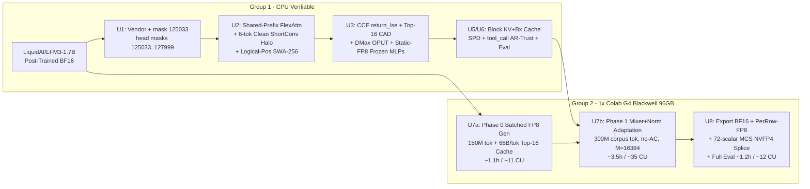

# feat: Convert LFM3-1.7B into a parallel block-diffusion language model

## Goal Capsule

**Objective.** `LiquidAI/LFM3-1.7B` generates text at **≥4.5 TPF** (target `5.0–6.8`, a cross-architecture estimate pending `U6` parity-sim measurement) on `<think>`/prose/math/code while preserving exact schema/tool-call validity (`<tool_call>`) and ≥90% of its post-trained benchmark strength in `SPD` mode (≥95% under `AR-Trust` verification), shipping in BF16 (`3.46 GB`), native PerRow FP8 (`2.21 GB`), and Blackwell MLP-NVFP4 (`1.83 GB`) within ~55–75 Colab Compute Units (~6–7.5 hours on 1× Colab `G4`).

**Means.** Direct conversion of post-trained `LiquidAI/LFM3-1.7B` on Colab `G4` (RTX PRO 6000 Blackwell 96 GB, SM120) by freezing the 80.7% position-wise weights (`1,132.5M` SwiGLU MLPs in FP8 + `262.1M` active embeddings), full-rank adapting all `334.2M` sequence-mixing + Sandwich-RMSNorm weights (`KTD1`, `KTD2`) over a shared-prefix `[P | R_clean | R_m1 | R_m2]` layout (`KTD4`) with an offline 150M-token self-generated Top-16 teacher logprob cache, `CForce` Confidence-Adaptive KL, and `DMax` on-policy token revision (`KTD3`, `KTD5`), followed by 72-scalar `MCS` splice into `LFM3-1.7B-NVFP4` (`KTD9`).

**Authority.** The Product Contract governs scope. Where implementation surfaces a conflict with a KTD, measured evidence on `G4` overrides unmeasured estimates; record any deviation in this file rather than silently changing scope.

**Stop conditions.** Stop and report if (a) `G4` sustained throughput after `U3` falls below `18k` corpus tokens/s, (b) validation code-AST / JSON-schema pass rate after the 50M-token MLP-unfreeze fallback (`KTD2`) lags the AR baseline by >5 points, or (c) Colab balance drops below `~160 CU` (preserving >45% of the `249.01 CU` balance, firing before the `≤90 CU` cap in R7 can be exceeded, and never stopping the operator's resident `L4` session).

**Execution profile.** Two PR groups. Group 1 (`U1–U6`) is 100% CPU-verifiable and merges before spending GPU CUs; Group 2 (`U7–U8`) executes Phase 0 caching, Phase 1 single-session `G4` training, and quantized export/evaluation.

**Who ships.** The implementing agent lands Group 1 and CPU tests; Group 2 runs via `colab` CLI on a dedicated `G4` session without touching existing sessions.

---

## Product Contract

### Summary
Convert post-trained `LiquidAI/LFM3-1.7B` in-place into a dual-mode block-diffusion language model (`B=32`) that achieves 5–7 tokens/forward via Soft Parallel Decoding on reasoning/prose, switches automatically to lossless single-pass `AR-Trust` self-speculative verification inside `<tool_call>` blocks, and exports directly to BF16, PerRow-FP8 (`SM89+`), and MLP-NVFP4 (`SM120+`).

### Problem Frame
`LiquidAI/LFM3-1.7B` (`1,728.8M` params, `128,000` tied vocab, 24 layers: 13 gated width-7 causal `ShortConv`, 5 `SWA-256`, 6 global GQA layers with headwise sigmoid output gates and Sandwich RMSNorms) already embeds 22T pretraining tokens plus 1.75T tokens of SFT, Mixed RL, 6-teacher MOPD, and Agentic RL (`71.39` BFCL-v4). Its bottleneck is serial 1-token/step AR decoding.

Byte-level inspection of `LiquidAI/LFM3-1.7B-NVFP4` and 7 open-source 2025–2026 conversion codebases exposed why earlier plans were 5–10× too expensive and carried silent bugs:
1. **80.7% of LFM3-1.7B is strictly position-wise**: the 24 SwiGLU MLPs (`1,132.5M`, `65.5%`) and `embed_tokens`/`lm_head` (`262.1M`, `15.2%`) have zero cross-token mixing. All 11 attention + 13 `ShortConv` + 96 Sandwich RMSNorms total just **`334.2M` parameters (`19.3%`)** — the exact BF16 boundary Liquid AI preserved in `LFM3-1.7B-NVFP4`.
2. **Every `<5B`-token conversion (`Fast-dLLM v2`, `OPDLM`, `d-OPD`, `FLARE`, `I-DLM`, `JacobiForcing`, `Orthrus`) starts from the post-trained checkpoint**, never `Base`.
3. **Reference trainers (`Fast-dLLM v2`, `dllm`) waste `2×–4×` FLOPs** duplicating prompts into `[2B, 2L]`, silently corrupt `ShortConv` block boundaries with noisy lags, blind `SWA-256` across two-stream offsets, and suffer a `2.8×–17×` `Liger` chunking regression at `V/H = 128000/2048 = 62.5`.
4. **Colab `G4` (`RTX PRO 6000 Blackwell Server`, `96 GB GDDR7`, `SM120`, `10.05 CU/h`) is eligible on this account**, delivering ~`1,000 TFLOPS` dense FP8 + `96 GB` no-checkpointing VRAM for cheaper than `A100-80GB` (`10.82 CU/h`).

### Requirements

- **R1. Post-trained seed & mask token.** Initialize from `LiquidAI/LFM3-1.7B` (post-trained); the mask token is unused row `125033` (keeping `vocab_size = 128,000` 256-aligned), and rows `125033..127999` are excluded from the output softmax by passing the sliced classifier `lm_head.weight[:125033]` (not a `-inf` logit mask — `cut-cross-entropy` has no mask hook and a zeroed row contributes `exp(0)` to `LSE`) so tied input/output gradients never conflict.
- **R2. Exact hybrid state handoff.** All 13 `Lfm3ShortConv` layers remain causal within blocks and seed each noisy block with the exact `W-1 = 6` preceding *clean* `Bx` tokens (`0` across packed document boundaries); all 5 `SWA-256` layers gate windows on logical RoPE position, never physical tensor index.
- **R3. Preserved clean-stream AR fidelity.** With `attention_mode="causal"`, forward logits match upstream `LiquidAI/LFM3-1.7B` within BF16 tolerance, and training retains causal clean-stream supervision (`L_AR`) so one checkpoint supports both parallel diffusion and lossless `AR-Trust` self-verification.
- **R4. Single-stage parallel-ready objective.** Train over shared-prefix packed `[P | R_clean | R_m1 | R_m2]` sequences (`B=32`, Dream token shift) combining `CForce` Confidence-Adaptive KL against offline Top-16 BF16 teacher logprobs, `DMax` on-manifold token corruption (`OPUT`), and clean-stream `L_AR`, supervising only the first `im_end` (`124900`) and zero-weighting mask block-tail padding; labels are computed per stream (`−100` at every stream tail and packed `doc_id` boundary) so no predictor supervises its own target through `R_clean`.
- **R5. Dual-mode cached sampler.** Inference caches both `K/V` (11 attention layers) and the 6-token `Bx` halo (13 `ShortConv` layers) across committed blocks plus `small_block=8` sub-block KV, running `DMax` Soft Parallel Decoding (`SPD`) by default and auto-switching to lossless `AR-Trust` strided verification inside `<tool_call>...</tool_call>` or strict JSON mode.
- **R6. Locked evaluation & token-parity simulation.** Evaluate AR baseline and converted checkpoints under one pinned harness (math, code, IFEval, and BFCL/XML tool-call schema validity), reporting per-benchmark-family retention and iso-precision wall-clock `tok/s` (BF16 vs BF16, PerRow-FP8 vs PerRow-FP8, NVFP4 vs NVFP4) alongside the headline speedup, plus a token-parity simulator that measures exact token-for-token agreement, divergence step, and step-budget efficiency (`TPF` and wall-clock `tok/s`) against the AR baseline; never compare dLM ELBO to AR perplexity.
- **R7. Budget-bounded execution.** Complete offline teacher caching, conversion training (`300M` corpus tokens = 2 epochs), and evaluation within `≤90 CU` on `1× G4`, never stopping or modifying the operator's active `L4` session. Phase 1 carries a `150M`-token retention checkpoint (record: no published sub-`1B`-token conversion has demonstrated ≥95% parity retention — `300M` is a Phase-1 budget, not a parity guarantee).
- **R8. Tri-format deliverable.** Export and smoke-verify BF16 (`3.46 GB`), `compressed-tensors` PerChannel-W8/PerRow-A8 `FP8_DYNAMIC` (`2.21 GB` for `L4`/`G4`), and Masked-Calibration-Simulated (`MCS`) `NVFP4` (`1.83 GB` for `G4`/Blackwell) under LFM Open License v1.0.

### Key Decisions

- **KD1 (Post-trained `LFM3-1.7B` seed over `Base`).** Preserves 1.75T SFT + RL + 6-teacher MOPD + `<think>` + `<tool_call>` alignment that cannot be reconstructed under `<5B` tokens. Governs R1, R3, R5.
- **KD2 (Freeze position-wise MLPs & active embeddings; full-rank train mixers + 96 norms).** Adapts 100% of positional mixing (`334.2M` params) while preventing MLP knowledge forgetting, cutting `wgrad` FLOPs/VRAM, and enabling zero-weight-requant splice into `LFM3-1.7B-NVFP4`. Governs R2, R7, R8.
- **KD3 (Single-stage `CForce CAD` + `DMax OPUT` over separate Stage C `dParallel`).** Reaches 5–7 TPF in one run without `dParallel`'s catastrophic static-decoding calibration collapse (`80.6% -> 0.23%` GSM8K). Governs R4, R5, R7.
- **KD4 (Dual-mode `<tool_call>` `AR-Trust` guard).** Eliminates the ACL 2026 agentic schema-corruption failure (`0.0%` BFCL under unverified parallel unmasking) using the clean causal stream already trained by `L_AR`. Governs R3, R5, R6.
- **KD5 (LFM Open License v1.0 compliance).** Derivatives retain license, `NOTICE`, and attribution; commercial use ≥$10M ARR requires a Liquid AI license. Governs R8.

### Success Criteria

- **SC1 (Parallelism & Speed).** Converted checkpoint achieves **≥4.5 TPF** (target `5.0–6.8 TPF`; cross-architecture estimate from `DMax`/LLaDA-MoE lineage, pending `U6` parity-sim measurement) on math/code/`think` prompts under `SPD`, **≥2.5 TPF** with **100% XML/JSON parse validity** on `tool_call` prompts under `AR-Trust`, and **≥3.5× single-stream `tok/s`** over BF16 AR on `G4` (NVFP4/FP8) and `L4` (PerRow-FP8) measured iso-precision (BF16 vs BF16, PerRow-FP8 vs PerRow-FP8, NVFP4 vs NVFP4) so quantization bandwidth never substitutes for parallelism gains.
- **SC2 (Capability Retention).** Retains **≥90% SPD-mode / ≥95% `AR-Trust`-verified** of `LiquidAI/LFM3-1.7B`'s score on the pinned math/code/IFEval/tool-call eval suite (within `−3.0` average points, reported per benchmark family). The clean stream is structurally preserved by `L_AR` + the frozen trunk, and `tool_call` spans already route through `AR-Trust`; the `150M`-token retention gate in `U7` confirms or aborts Phase 1.
- **SC3 (Budget & Throughput).** `G4` training sustains **≥22k corpus tokens/s** (`≥40k` physical tokens/s) with peak VRAM `<65 GB` (no activation checkpointing), finishing end-to-end under `90 CU`.
- **SC4 (Invariants as Tests).** R1 (masked output-head exclusion), R2 (bit-exact `ShortConv` clean-halo equivalence & logical-pos SWA), and R3 (causal logit equivalence) are enforced by automated CPU tests before any `G4` session launches.

### Scope Boundaries

In scope: `LiquidAI/LFM3-1.7B` text conversion, offline self-distilled Top-16 cache, single-stage block-diffusion (`B=32`) training on `G4`, dual-mode cached sampler, BF16 + `FP8_DYNAMIC` + `MCS`-calibrated `NVFP4` exports.

Out of scope (considered and rejected with evidence):
- **Using `LiquidAI/LFM3-1.7B-NVFP4` directly for uncalibrated student forward or `transformers` loading**: `"quant_method": "modelopt"` fails in `transformers`, `sglang#46858` is unmerged, W4A4 is `0.46×–0.95×` slower than BF16 at `M <= 2048`, and AR-calibrated static `input_scale` clips under `4×–16×` `<|mask|>` activation shifts (`arXiv:2610.07121`).
- **Exporting `128×128` `FP8_BLOCK` (like `LiquidAI/LFM3-1.7B-FP8`)**: `transformers` `CompressedTensorsFP8Linear` silently decompresses 2D blocks to BF16; we export 1D PerChannel-W8 / Dynamic PerRow-A8 (`FP8_DYNAMIC`) so native `scaled_mm` FP8 Tensor Cores run out-of-the-box.
- **`TransformerEngine` NVFP4/MXFP8 or FA3/FA4 on `G4` (`SM120`)**: TE leaks `3.9 GiB` via `TE#3765` and crashes on `SM100`-only `cvt.rs.e2m1`; FA3 is `SM90`-only and FA4 lacks custom block-diffusion backward.
- **Default `LigerFusedLinearCrossEntropyLoss`**: `V/H = 62.5` triggers `inc_factor=63` micro-chunking (`2.8×–17×` slower than eager); replaced by masked gather + Apple `cut-cross-entropy` (`return_lse=True`).
- **Colab TPU `v6e-1`**: `-42%` MXU utilization penalty at `head_dim=128`, no custom width-7 conv halo kernels, and XLA block-warmup recompiles.
- **Multimodal LFM3 variants (`VL`, `Audio`, `Omni`), RL post-training, and >4K long-context claims**: deferred.

### Dependencies

- **Compute (live-verified 2026-11-08 via `colab new --gpu G4`).** Colab Pro balance: **`249.01 CU`**. Primary workhorse: **`colab new --gpu G4`** (Google Cloud's G4 VM class = **`NVIDIA RTX PRO 6000 Blackwell Server Edition`, `97,887 MiB` GDDR7 @ `1,597 GB/s`, `48 vCPUs`, `189.9 GB` RAM, `253.0 GB` free SSD, `CC (12, 0)`, `~500` BF16 / `~1,000` FP8 / `~2,000` NVFP4 dense TFLOPS, `10.05 CU/h`** — provisioned live in 4.8s). Zero-code-change fallback if `G4` pool stock ever throttles: **`colab new --gpu A100`** (`A100-40GB`, `5.30 CU/h`, BF16 frozen-MLP fits in `~28 GB` without AC, `~65 CU` total). Existing operator sessions are never stopped or modified.
- **Prompt Mixture (`~130K` prompts → `150M` teacher tokens).** Public HF datasets: `divelab/opdlm_train_data` (`61.8K` math/code/STEM/chat prompts, verified HTTP 200) + `nvidia/Llama-Nemotron-Post-Training-Dataset` (math/code/tool-calling subsets) + `LiquidAI/structured-extraction`.
- **Software Stack (`G4` ships `torch 2.14.1+cu130`).** `transformers>=5.20.2,<=5.21.0` (pinned: `nvidia-modelopt[hf]` requires `transformers<5.19` and `llmcompressor` `<=5.21.0` — the `modelopt` fallback runs in a separate venv or `--no-deps`), `torchao>=0.18.0`, `cut-cross-entropy` (`apple/ml-cross-entropy`), `safetensors`, `datasets`; optional `nvidia-modelopt` / `llm-compressor` / `kernels-community/nvfp4-gemm` for U8 export.

### Sources

Primary code & checkpoints inspected: `LiquidAI/LFM3-1.7B`, `LiquidAI/LFM3-1.7B-NVFP4`, `LiquidAI/LFM3-1.7B-FP8`, `LiquidAI/d1-2B` (`attention.py`, `depthwise.py`), `LiquidAI/masked-diffusion` (`lfm2_diffusion.py`), `Liquid4All/cookbook` (`lfm3_sft_with_trl.ipynb`), `NVlabs/Fast-dLLM` (`v2`), `mit-han-lab/d-OPD`, `divelab/OPDLM`, `yuchen-zhu-zyc/FLARE`, `Introspective-Diffusion/I-DLM`, `chiennv2000/orthrus`, `hao-ai-lab/JacobiForcing`. Research dossiers: `/tmp/compound-engineering-1000/ce-plan-research/f0efa364/` (`01–23`).

---

## Planning Contract

### Key Technical Decisions

**KTD1. Exact Hybrid Block-Diffusion Surgery (`6-Token Clean ShortConv Halo` + `Logical-Pos SWA-256`).**
- **13 `Lfm3ShortConv` (`k=7`) layers**: Remain causal FIR filters on `Bx = B_gate * x`. In packed `[P | R_clean | R_m1 | R_m2]`, `in_proj` and `out_proj` run once on un-haloed tokens; for `R_m1` and `R_m2`, each `B=32` block prepends the **6 preceding clean `Bx` tokens from `[P | R_clean]`** (zeroed across `doc_id` boundaries) into `[N_blocks, 2048, 38]` before `F.conv1d(..., groups=2048, padding=0)`. Eliminates cross-block mask leakage (`FLARE` App. A.1) in 10 lines of `torch.compile`-clean PyTorch (`0.01%` FLOPs).
- **6 `full_attention` + 5 `sliding_attention` layers**: Dispatched via `FlexAttention` `create_block_mask` (`sm_120a`) during training and `cuDNN SDPA` / custom `AttentionInterface` (following `LiquidAI/d1-2B/attention.py`) at inference. `R_clean` is strictly causal; `R_m1`/`R_m2` attend bidirectionally within their `B=32` block and causally to `P` + strictly earlier `R_clean` blocks. `sliding_attention` enforces **`0 <= (logical_pos_q - logical_pos_kv) < 256`** so two-stream index offsets never blind `R_m1`/`R_m2` to `R_clean`.
- **Dream Token Shift preserved**: Position `i-1` predicts token `i` (`+15` GSM8K pts in DiffuLLaMA; free first token of block `b+1` on clean block commit in `Fast-dLLM v2`).

**KTD2. Mixer-Only Full-Rank BF16 Training (`334.2M` Params) + Fused Static-FP8 Frozen MLPs (`1,132.5M`).**
Freeze `embed_tokens[0:125033]` (`262.1M`) and all 24 SwiGLU MLPs (`1,132.5M`), Concatenate frozen `w1` + `w3` into `w13 [15360, 2048]` and store frozen `w13, w2` (and contiguous transposes for `dgrad`) in per-channel `float8_e4m3fn` (`torch._scaled_mm` inside a custom dgrad-only `autograd.Function` per `U3` — `torchao`'s `Float8Linear` computes `wgrad` unconditionally even on frozen weights, so it wraps only the trainable mixer linears), running `77.2%` of trunk forward+`dgrad` on `G4`'s `1,000 TFLOPS` FP8 Tensor Cores with **zero `wgrad` (`-26.9%` FLOPs)** and **no activation checkpointing** (`~34 GB` peak VRAM at `M_phys = 16,384`). Train full-rank BF16 (`FP32` master AdamW = `3.34 GB`) on all `11 Lfm3Attention` (`q,k,v,o,gate_proj,q/k_norm`), all `13 Lfm3ShortConv` (`in_proj,conv,out_proj`), all `96 Sandwich RMSNorms`, and mask row `125033` (initialized via `copy_pad_embedding_to_mask`).
- *Fallback gate*: If validation code-AST pass rate at `250M` tokens trails AR by >3 pts, run a `50M`-token polish unfreezing MLPs at differential `LR = 1e-6` (`mixers = 2e-5`) via `torchao.float8.convert_to_float8_training(model, config=Float8LinearConfig.from_recipe_name("rowwise"), module_filter_fn=<frozen MLP modules>)`.

**KTD3. Offline Self-Generated Trajectory + Compact `68 B/tok` Top-16 BF16 Logprob Cache.**
Instead of `OPDLM`'s `124 tok/s` online rollout bottleneck (`159 H100-h`), run `LiquidAI/LFM3-1.7B` compiled with `torchao` PerRow-FP8 on `G4` (`batch=256–512`, `cuDNN SDPA`) over `~130K` prompts (`35%` `<think>` math/STEM, `30%` AST/test-verified code, `20%` XML `<tool_call>` traces, `15%` `enable_thinking=False` JSON/chat) to emit **`150M` response tokens** AND extract exact Top-16 teacher candidates (`99.45%` probability mass) in the same session (`~1.1h = ~11 CU`). Store each token in **`68 bytes`** (`16 × uint16` low IDs + `1 × uint16` 17th-bit mask for `vocab=128,000 > 65,535` + `16 × bf16` logprobs + `bf16` residual mass = **`10.2 GB` total on disk**).

**KTD4. Shared-Prefix Complementary Packing (`[P | R_clean | R_m1 | R_m2]`).**
Pack multiple prompt-response pairs to fixed `S_phys = 4096` (`M_phys = 16,384` at `microbatch=4`) using `[P | R_clean | R_m1 | R_m2]` (`P + 3R` physical tokens instead of `Fast-dLLM v2`'s `4P + 4R` — a **`2.0×–2.5×` full-model FLOP reduction**; published precedent: `MMT` EMNLP 2026 shared-clean-stream complementary pairs, `LLaDA2.0` two-stream `[x_t ; x_0]` with per-stream block reindexing). `block_id` and `position_ids` are computed in **per-stream logical coordinates** — a physical-index block computation would let a noisy predictor's block outrank all clean blocks and see its own shifted target. Pad each response tail to a `B=32` multiple with **zero-loss mask padding (`125033`)** while supervising **only the single true `im_end` (`124900`)** at weight `1.0`, and set labels `−100` at every stream tail (`P+R−1`, `P+2R−1`, `R_clean` tail) and packed `doc_id` boundary (the `FLARE` `_fix_doc_boundary` precedent; Fast-dLLM v2 avoids the class by putting complementary views in separate batch rows).

**KTD5. Single-Pass `cut-cross-entropy` Reused-LSE Loss (`CForce CAD` + `DMax OPUT` + `L_AR`).**
1. Gather active loss hidden states `h_valid` BEFORE `lm_head` (`-45%` head FLOPs); the output softmax excludes rows `125033..127999` by passing the **sliced classifier** `lm_head.weight[:125033]` (a contiguous backward-safe view) to `cut-cross-entropy`, teacher-cache extraction, and the sampler — never by zeroing rows (`exp(0)` corrupts `LSE` by `ln 12767 ≈ 9.45`) or a `-inf` mask (CCE has no mask hook; the exact alternative is a `[0×125033 | −inf×2967]` bias vector).
2. Call `cut-cross-entropy` (`linear_cross_entropy(..., return_lse=True, filter_eps=None)`) **once** on the sliced classifier to get exact `LSE(z_S)` in SRAM (`1.55×` faster, `24×` less VRAM than eager; avoids Liger's `17×` `V/H=62.5` regression), then compute Top-16 `CForce` Confidence-Adaptive KL via a tiny `[M_valid, 16, 2048]` sparse gather-dot (`<2%` step overhead), where the residual tail enters **as one bucket** `p_S(τ)·log(p_S(τ)/p_T(τ))` (or the teacher is renormalized on top-k support, per `CForce` App. B) with `c_T = max` over `top-16 ∪ {τ}` — unrenormalized, `L_CAD(p_θ=p_T) ≈ −5.5e−3` and the `U3` equals-0 test fails. The `0.2 * CE` term supervises **revealed/clean positions only** (disjoint from `L_CAD`'s masked set, per `CForce`'s `Δ_i`), and `L_AR` uses hard CE auto-balanced `L_CAD + (L_CAD.detach()/L_AR.detach())·L_AR` (FLARE `loss_auto_balance`) with a `causal_x0` assert whenever `w_AR > 0`; gather-dot logits are cast to `bf16` before `z−LSE` to match CCE's rounding.
3. **Two-phase on-manifold corruption**: Tokens `0–120M` corrupt `80%` of selected block slots (`t ~ P-POTS U[0.35, 0.95]`, block warmup `4→8→16→32` over first `40M` tokens, then continued annealing across the run per `Fast-dVLM`/`d3LLM` evidence — `-4.4%`/`-32.5%` when truncated) to the mask token and `20%` to non-argmax tokens sampled from cached teacher Top-16 (0 extra passes); tokens `120M–300M` run 1 detached student `x_t^(p)` pass (`DMax` OPUT) on `50%` of steps (`+16%` avg FLOPs) — the corrupted input uses the *same* blend as inference (`π·e(ŷ)+(1−π)·e_mask`, `π~U[0,1]`, `ŷ` from the detached pass) since `DMax` never trains soft embeddings — and supervise *all* active-block positions for self-revision, plus the auto-balanced `L_AR(R_clean)` term from step 2.

**KTD6. Exact Block `KV + Bx` Cache + Dual-Mode (`SPD` / `AR-Trust`) Sampler.**
At inference, committed blocks never re-run (unlike full-bidirectional `lfm2_diffusion.py`): each block `b` runs all 24 layers on **only `B=32` tokens** (or `small_block=8` sub-blocks) reading cached `K/V` (full prefix on 6 global layers, 256-token ring buffer on 5 SWA layers) and the cached 6-token `Bx` state (13 `ShortConv` layers), committing clean `K/V` + `Bx[-6:]` + next-block token 0 in one pass. **Lossless `K/V`**: verification `K/V` must come from a strictly causal stream — so each SPD step runs a two-stream `[clean | noisy]` block forward (FLARE's design, ~`+1.5%` e2e FLOPs) or re-prefills causally on each mode switch, accepted tokens re-enter as clean, and committed `K/V` is cropped to accepted length on rejection (`I-DLM` `2N−1` anchor accounting; `DMax`/`SpecCTMC` cover the T>0 path only).
- **Default mode (`SPD`)**: `DMax` Soft Parallel Decoding — student logits are **shifted before blending** (`z ← cat([z[:,:1], z[:,:-1]])`, mirroring Fast-dLLM's shift-before-argmax so `p_j` predicts `x_j`, not `x_{j+1}`), then blend `c·E_{v~p}[e(v)] + e_mask` on confident prefix tokens `c_j > 0.55` (`c ≤ 0.30` per `DMax` `h2e`), hard commit on 2-step top-1 consistency or `c_j > 0.90` (`EOS` via per-row `finished_flag` + pad, not post-hoc strip). Optional `entropy multi-block` decode (`d3LLM`) behind a flag gated on `U6` parity sweep; optional `scaffold_prefill` under `strict_schema` (deterministic `tool_call` keys pre-filled unmasked).
- **Schema/Tool mode (`AR-Trust` / `ISD`)**: Triggered automatically when `tool_call` (`125019`) is emitted (until `tool_call` close `125020`) or when `strict_schema=True`: feeds `[accepted_clean | MASK × 4..7]` on the **strictly causal** path, verifying drafts losslessly against the clean distribution (`2.5–3.8 TPF`, `0%` syntax corruption) — `p` is only `p_AR` when anchor `K/V` are causal (two-stream forward or causal re-prefill per the `K/V` rule above); `Dang & Ermon` finite-automata constrained decoding (`arXiv:2607.07026`, `<5%` overhead, guaranteed validity) is the cited fallback if statistical schema-validity ever suffices over token-parity.

**KTD7. `torchao` & `SM120` Safety Guards.**
Patch `torch.inference_mode = torch.no_grad` whenever `torchao` FP8 modules are active (avoids `version_counter` crash), compile at fixed `S_phys = 4096` (`dynamic=False`), **never `mode="max-autotune"`/`EXHAUSTIVE` on `SM120`** (no `sm12x` smem pruning → `OutOfResources`; rely on stock `sm12x` heuristics or explicit `kernel_options` `fwd 128/64/s2/w8, bwd 64/64/64/64/s1` at `head_dim=128`), and sync full resumable state (`334.2M` mixer weights + `3.34 GB` optimizer + RNG + shard cursor) every `75M` corpus tokens (~45 min on `G4`).

**KTD8. Locked Evaluation Protocol & Token-Parity Simulation.**
Pin benchmark suite (`GSM8K`, `MATH-500`, `HumanEval-Plus`, `IFEval`, `BFCL-XML` / `LiquidAI/structured-extraction`) + generative perplexity under an independent AR scorer; log `(mode, B, small_block, tau_dec, tau_acc, TPF, tok/s, peak_VRAM)` on every run. Add an offline/live **token-parity simulator** (`token_parity.py`) that replays AR ground-truth trajectories through the block-diffusion sampler (`SPD` at swept `tau_dec/tau_acc` and `AR-Trust` at `stride=4..7`, matching `KTD6`'s `MASK × 4..7` operating range) to report exact match rate, prefix parity length before first divergence, acceptance efficiency, and predicted vs. realized `TPF`/`tok/s` speedup curves before committing long benchmark runs.

**KTD9. Dual Quantized Export (`PerRow-FP8` + Zero-Weight-Requant `MCS-NVFP4`).**
1. **`LFM3-1.7B-Diffusion-FP8` (`2.21 GB`, `L4` & `G4` native)**: Export via `compressed-tensors` using **1D PerChannel-W8 + Dynamic PerRow-A8** (`FP8_DYNAMIC`, *not* `128×128` `FP8_BLOCK`) on `feed_forward.*` and `self_attn.{q,k,v,o}_proj`, keeping `conv*`, `gate_proj`, `embed/lm_head`, and norms in BF16 so `transformers` (`use_optimized_inference=True` + `torch.compile`) runs native `scaled_mm` FP8 Tensor Cores directly.
2. **`LFM3-1.7B-Diffusion-NVFP4` (`1.83 GB`, `G4`/Blackwell flagship)**: When MLPs remain frozen (`KTD2`), splice trained BF16 mixers/norms/embeddings directly onto `LiquidAI/LFM3-1.7B-NVFP4`'s untouched `U8 + F8_E4M3` MLP tensors and run **256 Masked Calibration Simulation (`MCS`, `r ∈ [0.1..1.0]`) forwards (~30s = `0.1 CU`)** to update the **72 `F32` `input_scale` scalars** with diffusion headroom (plus ship a 25-line `transformers` `NVFP4Config` `kernels-community/nvfp4-gemm` loader scoped to **W4A16 GEMV at `M <= 2048` with standard BF16 KV** — W4A4 FP4 GEMM dispatch and commit-time FP4/FP8 KV move to Deferred long-context work; `nvfp4-gemm` API is unverified, `PerRow-FP8` stays the zero-risk fallback). If the MLP-unfreeze fallback ran, re-quantize MLPs via `nvidia-modelopt` `nvfp4_mlp_only_mse` + 500-step `QAD` (`~2.5 CU`, separate venv — `modelopt` pins `transformers<5.19`).

### High-Level Technical Design



Shared-prefix tensor & halo layout (directional, not implementation code):

```
Packed sequence (S_phys = 4096):
  tokens:       [ P          | R_clean     | R_m1 (masked/OPUT) | R_m2 (complement) ]
  position_ids: [ 0..P-1     | P..P+R-1    | P..P+R-1           | P..P+R-1          ]
  stream_id:    [ 0 (clean)  | 0 (clean)   | 1 (noisy_1)        | 2 (noisy_2)       ]

Attention rule (FlexAttention BlockMask, doc_id isolated):
  stream 0 -> stream 0: causal (pos_kv <= pos_q)
  stream s in {1,2} -> stream 0: strictly earlier clean blocks (block_kv < block_q) + all P
  stream s in {1,2} -> stream s: intra-block bidirectional (block_kv == block_q)
  SWA-256 overlay (5 layers):    0 <= (pos_q - pos_kv) < 256   # logical pos, NEVER tensor idx!

ShortConv(k=7) rule (13 layers):
  Bx = B_gate * x from single un-haloed in_proj([P | R_clean | R_m1 | R_m2])
  clean stream: causal conv1d masked by doc_id
  noisy block b in {R_m1, R_m2}: conv1d(cat([Bx_clean[b*32-6 : b*32], Bx_noisy[b]]), padding=0)
```

### Risks & Mitigations

- **Frozen-MLP expressivity on a `ShortConv` hybrid (`KTD2`)**: `Repr-Align`'s frozen-MLP win was measured on pure-attention `Qwen3-1.7B`; `BYOD`'s `~77%` LoRA floor and `dQwen3.5`'s small-scale conv-hybrid collapse at `50B` tokens bound the downside — mixer-only `≥95%` is an unverified extrapolation, the `150M` retention gate in `U7` is the arbiter. Mitigation: all 96 Sandwich RMSNorms and all 24 `out_proj`/`o_proj` (`2048×2048`) are full-rank trainable, and the `50M`-token `LR=1e-6` MLP-unfreeze fallback (`~6 CU`, full-suite gate) is pre-wired in `U3`. **Contingency**: if it fires, `nvidia-modelopt` `nvfp4_mlp_only_mse` + 500-step `QAD` (`~2.5 CU`, separate venv) re-quantizes MLPs for `U8`.
- **`SM120` ABI mismatch on optional external wheels**: `cut-cross-entropy` (Triton) and `torchao.float8` (`torch._scaled_mm`) run on stock `torch 2.14.1+cu130` with zero custom C++ compilation; `kernels-community/nvfp4-gemm` is smoke-checked in 60s in `U8` with W4A16 Triton / PerRow-FP8 as zero-risk fallback.
- **Parallel tool-call syntax corruption (`arXiv:2601.12979`)**: Mitigated structurally by `KTD6` (`<tool_call>` triggers clean-stream `AR-Trust` lossless verification) and tested directly in `U5`/`U6`.

---

## Implementation Units

### PR group 1 — Core architecture, trainer, sampler, and eval (100% CPU-verifiable)

Waits on: nothing.

#### U1. Vendor LFM3 (`LiquidAI/LFM3-1.7B`), register `<|mask|>`, and isolate dead vocab rows
- **Goal.** Standalone `lfm3_dlm` package loading `LiquidAI/LFM3-1.7B` with the mask token at `125033` and the output classifier sliced to `lm_head.weight[:125033]`.
- **Requirements.** R1, R3
- **Dependencies.** none
- **Files.** `lfm3_dlm/__init__.py`, `lfm3_dlm/configuration_lfm3.py`, `lfm3_dlm/modeling_lfm3.py`, `lfm3_dlm/lfm3_conv.py`, `lfm3_dlm/tokenizer.py`, `tests/test_registration.py`, `tests/test_mask_vocab_isolation.py`
- **Approach.** Vendor the `LiquidAI/LFM3-1.7B` modeling files (which include `lfm3_conv.py`, unlike the older copy in `LFM3-1.7B-NVFP4`); map the mask token to `125033` initialized from pad (`124893`); keep `vocab_size=128,000` for 256-aligned Tensor Core GEMMs. Add `attention_mode` (`causal` | `block_diffusion`) to `configuration_lfm3.py` so R3's causal-fidelity test has a real switch (upstream `Lfm3Attention.is_causal` is hard-coded). Output-side exclusion of `125033..127999` uses the sliced classifier `lm_head.weight[:125033]` wherever logits/LSE are computed (loss, teacher cache, sampler) — embedding gradients on rows `0..125032` and `125034..127999` stay zeroed under mixer-freeze mode.
- **Test scenarios.**
  - Causal mode logits match upstream `trust_remote_code=True` within BF16 tolerance (`atol=1e-3`) over `0..125032`.
  - `<|mask|>` encodes/decodes to `[125033]`, output probabilities over `125033..127999` are identically `0.0`, and backward through loss updates `embed_tokens.weight[125033]` while leaving `embed_tokens.weight[:125033]` bit-identical when frozen.
- **Verification.** `pytest tests/test_registration.py tests/test_mask_vocab_isolation.py` passes on CPU with a 2-layer synthetic LFM3 config.

#### U2. Shared-prefix `FlexAttention` masks, logical-position `SWA-256`, and 6-token clean `ShortConv` halo
- **Goal.** Exact train-inference equivalence across all 24 hybrid layers on packed `[P | R_clean | R_m1 | R_m2]` sequences.
- **Requirements.** R2, R3
- **Dependencies.** U1
- **Files.** `lfm3_dlm/masks.py`, `lfm3_dlm/conv_halo.py`, `lfm3_dlm/modeling_lfm3.py`, `tests/test_masks_and_swa.py`, `tests/test_shortconv_halo.py`
- **Approach.**
  1. Build `FlexAttention` `mask_mod` parameterized by `(doc_id, stream_id, logical_pos, block_id)` supporting `causal` and `block_bidirectional` (`B=32`, warmup `4→8→16→32`, then continued anneal per `Fast-dVLM`), with `SWA-256` checking `0 <= (logical_pos_q - logical_pos_kv) < 256` (plus dense boolean fallback on CPU so all unit tests run locally without CUDA). `block_id` is per-stream logical (restarts per stream — the `MMT`/`LLaDA2.0` reindexing rule), never physical index. When `attention_mask` is passed as a per-layer-type dict it must include `"conv"` (else `KeyError`) and conv document isolation is driven by the collator's `doc_id` (upstream `seq_idx` derivation is disabled under dict masks — don't rely on it).
  2. Implement `ShortConv` clean-halo gather: slice the 6 preceding clean `Bx` tokens from `stream 0` before each noisy block (zeroed at `doc_id` boundaries) and run depthwise `F.conv1d(..., padding=0)`.
- **Test scenarios.**
  - **Train-inference equivalence (the critical hybrid invariant)**: For any multi-block sequence where blocks `< b` are clean and block `b` is partially masked, running block `b` inside packed `[P | R_clean | R_m1 | R_m2]` yields **bit-identical** hidden states on all 24 layers (13 `ShortConv`, 5 `SWA-256`, 6 `full_attention`) to running sequential prefix prefill `[P | R_clean[:b*B]]` followed by active block `R_m1[b]` at `R >= 512` (where physical index distance exceeds 256!).
  - **Cross-block & cross-document isolation**: Perturbing noisy tokens in `R_m1` block `b-1` or in an adjacent packed document produces **zero** output delta (`atol=0`) in `R_m1` block `b` and in `R_clean`.
- **Verification.** `pytest tests/test_masks_and_swa.py tests/test_shortconv_halo.py` passes on CPU.

#### U3. Reused-LSE `cut-cross-entropy` + `CForce CAD` + `DMax OPUT` trainer & static-FP8 frozen-MLP wrapper
- **Goal.** High-throughput single-stage step module, shared-prefix collator, `68 B/tok` Top-16 cache reader, and `w13`-fused FP8 MLP wrapper.
- **Requirements.** R4, R7, KTD2–KTD5, KTD7
- **Dependencies.** U1, U2
- **Files.** `lfm3_dlm/train/loss_cad.py`, `lfm3_dlm/train/collator.py`, `lfm3_dlm/train/fp8_mlp.py`, `lfm3_dlm/train/trainer.py`, `lfm3_dlm/data/top16_cache.py`, `configs/g4_300m.yaml`, `tests/test_loss_cad.py`, `tests/test_collator_packing.py`, `tests/test_top16_cache.py`
- **Approach.**
  1. `top16_cache.py`: Pack/unpack `16 × uint16` low IDs + `uint16` 17th-bit high mask + `16 × bf16` logprobs + `bf16` residual mass (`68 B/tok`), lossless over `0..127999`.
  2. `collator.py`: Build `[P | R_clean | R_m1 | R_m2]` padded to `S_phys = 4096`, `P-POTS` stratified `t ~ U[0.35, 0.95]`, complementary masks `(m, 1-m)`, `80/20` mask vs Top-16 confusion corruption, single `im_end` weight `1.0`, mask block-tail padding weight `0.0`, Dream right-shift alignment **with per-stream labels** — `labels[i] = −100` at every stream tail (`P+R−1`, `P+2R−1`, `R_clean` tail) and every packed `doc_id` boundary; noisy-stream labels gather the clean target at `logical_pos+1`, never a physical `input_ids` shift.
  3. `loss_cad.py`: Gather loss positions `h_valid`, compute `LSE` once via `cut-cross-entropy` (`return_lse=True, filter_eps=None`, sliced classifier `lm_head.weight[:125033]`, pure-PyTorch reference fallback on CPU), evaluate `CForce` `L_CAD` (`forward_KL + c_T * reverse_KL` over Top-16 **+ one tail bucket** `p_S(τ)log(p_S(τ)/p_T(τ))`, `c_T` over `top-16 ∪ {τ}`) + `0.2 * CE` (revealed positions only) + auto-balanced `L_AR` (`(L_CAD.detach()/L_AR.detach())·L_AR`, `causal_x0` assert), plus Phase-2 50%-step detached `DMax OPUT` pass corrupting with the inference blend (`π·e(ŷ)+(1−π)·e_mask`, `π~U[0,1]`) and `75M`-token resumable checkpointer.
  4. `fp8_mlp.py`: Fuse `w1+w3 → w13`, freeze MLPs + active embeddings (exposing `unfreeze_mlp_lr=1e-6` flag). Frozen MLPs use a **custom `autograd.Function`** (forward `torch._scaled_mm` rowwise with col-major `w13_cm`/`w2_cm`, backward dgrad-only via `ctx.needs_input_grad[0]`) — `torchao`'s `Float8Linear` computes `wgrad` unconditionally even on frozen weights and would never deliver the `−26.9%` claim; `torchao` may still wrap the *trainable* mixer linears where `wgrad` is wanted. BF16 on CPU, guard `torch.inference_mode`.
- **Test scenarios.**
  - `68 B/tok` codec round-trips boundary token IDs (`0`, `65535`, `65536`, `124900`, `125032`, `127999`) bit-identically.
  - Reused-LSE `L_CAD` matches dense `128,000`-way FP64 reference forward+reverse KL (`atol=1e-4`), equals `0.0` when $p_\theta = p_T$, and increases reverse-KL sharpness monotonically with $c_T$.
  - Collator supervises every response token + first `im_end` exactly once across `(R_m1, R_m2)`, assigns zero gradient to `P` and mask tail padding, **and emits `−100` labels at every stream tail and `doc_id` boundary** (assert no supervised predictor attends its own label).
  - Resumable checkpoint restores identical step loss and RNG mask draws after reload.
- **Verification.** All CPU unit tests pass + 2-step synthetic training loop updates all `334.2M`-equivalent mixer/norm/mask params while keeping frozen MLP & non-mask embedding weights bit-identical.

#### U4. Checkpoint converter & standalone HF export (`convert.py`)
- **Goal.**Deterministic conversion between `LiquidAI/LFM3-1.7B` and the standalone `lfm3_dlm` checkpoint directory (unfused `w1, w2, w3` preserved for downstream HF/NVFP4 compatibility) with LFM Open License v1.0 files.
- **Requirements.** R1, R3, R8, KD5
- **Dependencies.** U1, U2, U3
- **Files.** `lfm3_dlm/convert.py`, `tests/test_convert.py`, `tests/test_nvfp4_mcs_splice.py`, `README.md`
- **Approach.** Convert source checkpoint (or merge trained mixer state back into unfused `LFM3` layout), copy `LICENSE`/`NOTICE`, write self-contained modeling + config + tokenizer (`<|mask|>` registered).
- **Test scenarios.**
  - Converted directory loads via `AutoModelForCausalLM.from_pretrained(..., trust_remote_code=True)`, matches causal AR logits (`atol=1e-3`), is idempotent across repeated runs, and includes `LICENSE`.
- **Verification.** `pytest tests/test_convert.py` passes on CPU.

#### U5. Block `KV + Bx` cached dual-mode sampler (`DMax SPD` + `<tool_call>` `AR-Trust`)
- **Goal.** Fast single-stream & batched inference engine supporting `DMax` Soft Parallel Decoding (`SPD`) and automatic lossless `AR-Trust` / `ISD` verification inside `<tool_call>` or JSON-schema spans.
- **Requirements.** R5, KD4, SC1
- **Dependencies.** U1, U2
- **Files.** `lfm3_dlm/sample/cache.py`, `lfm3_dlm/sample/dual_sampler.py`, `tests/test_dual_sampler.py`
- **Approach.**
  1. `cache.py`: Prefix `KV` cache (full on 6 global layers, 256-ring on 5 SWA layers) + 6-token `Bx` state cache (13 `ShortConv` layers) + `small_block=8` sub-block slice cache so denoising steps execute only `8` or `32` tokens across all 24 layers and grab token 0 of block `b+1` free on clean block commit; on `AR-Trust` rejection, committed `K/V` and `Bx` are **cropped back to the accepted length** (draft tokens' `K/V` are never committed).
  2. `dual_sampler.py`: Run `SPD` (**shift logits before blending**: `z ← cat([z[:,:1], z[:,:-1]])`, then `c·E_{v~p}[e(v)] + e_mask` on `c_j > 0.55`, `c ≤ 0.30`; commit on 2-step consistency or `c > 0.90`; per-row `finished_flag` + pad on `EOS`). The moment `tool_call` (`125019`) appears (or `mode="ar_trust"`), switch to causal `[clean | MASK × 4..7]` rejection-sampled verification (`ISD`) until `tool_call` close (`125020`), guaranteeing exact AR distribution on tool calls — **anchor `K/V` must be causal**: run the SPD block's two-stream `[clean | noisy]` forward per step (FLARE pattern) or re-prefill causally on the switch, re-entering accepted tokens as clean so their `K/V` is valid (`I-DLM` `2N−1` accounting: `N−1` anchors re-verify previously accepted tokens).
- **Test scenarios.**
  - `AR-Trust` greedy output is **100% token-for-token identical** to standard `B=1` causal AR greedy decoding on any model (including random 2-layer CPU weights!), **using causal-stream anchor `K/V` (two-stream forward or re-prefill)** — bidirectionally-committed `K/V` makes `p ≠ p_AR` and the guarantee false, while achieving `>1.0` TPF when draft predictions match.
  - Cached `B=32` / `small_block=8` step outputs match uncached full-prefix recomputation (`atol=1e-4`).
  - Emitting `<tool_call>` mid-generation switches `SPD → AR-Trust` and `</tool_call>` switches back without corrupting `KV` or `Bx` caches; `<|im_end|>` terminates cleanly.
- **Verification.** `pytest tests/test_dual_sampler.py` passes on CPU.

#### U6. Locked evaluation & token-parity simulation harness
- **Goal.** Single command scoring AR and dLM checkpoints on math, code, IFEval, XML `<tool_call>` / JSON validity, generative perplexity, `TPF`, `tok/s`, plus token-parity simulation against AR trajectories.
- **Requirements.** R6, KTD8, SC1, SC2
- **Dependencies.** U1, U5
- **Files.** `lfm3_dlm/eval/run_eval.py`, `lfm3_dlm/eval/token_parity.py`, `lfm3_dlm/eval/tool_schema_eval.py`, `lfm3_dlm/eval/settings.py`, `tests/test_eval_guardrails.py`, `tests/test_token_parity.py`
- **Approach.** Pin task subset, decode configs (`spd`, `ar_trust`, `hybrid_auto`), AST/XML/JSON parser checks (`LiquidAI/structured-extraction` + XML `tool_call` validator), and hard error if anyone invokes ELBO-vs-AR perplexity comparison. In `token_parity.py`, feed held-out AR ground-truth continuations (generated by `LiquidAI/LFM3-1.7B`) through both `SPD` threshold sweeps and `AR-Trust` teacher-forced block verification to simulate per-block token acceptance (`mean_accepted_len`, `stride=4..7`), prefix parity rate (`exact_match@step`), KL/top-1 flip rate, and estimated wall-clock speedup (`tok/s` vs AR) in seconds; losses report **token-global averaging** (per `Nemotron` `+2.12%`) and acceptance-length per mode.
- **Test scenarios.**
  - Missing decode metadata or attempted ELBO-to-AR PPL comparison raises `ValueError`.
  - XML `<tool_call>` and JSON schema validators catch malformed tags/keys and pass valid LFM3 tool calls.
  - `token_parity.py` reports `100.0%` token parity under `AR-Trust` greedy replay and exact analytical `TPF` counts on a synthetic model matching AR logits (`expected_tpf == B / num_steps`).
- **Verification.** `pytest tests/test_eval_guardrails.py tests/test_token_parity.py` passes on CPU.

---

### PR group 2 — `G4` Blackwell teacher caching, conversion run, and quantized exports

Waits on: PR group 1 merged and all CPU tests green. **Hard constraint: NEVER stop, restart, or touch the operator's existing `L4` session.**

#### U7. Phase 0 Top-16 teacher cache + Phase 1 single-session `G4` conversion (`~46–55 CU`)
- **Goal.** Generate `150M` self-distilled tokens (`10.2 GB` Top-16 BF16 cache) and train `300M` corpus tokens (2 epochs) on `1× Colab G4` (`RTX PRO 6000 Blackwell 96GB`), gating at `10M` (throughput), `150M` (**retention checkpoint: abort or trigger contingency if pinned-suite retention lags**), `250M` (code-AST → MLP-unfreeze per `KTD2`), and `300M` (epoch 2 + Top-5 checkpoint average); **Phase 1 launches only if `U6` token-parity simulation predicts `SPD` `TPF ≥ 4.5` on held-out AR trajectories**.
- **Requirements.** R4, R7, SC1–SC3
- **Dependencies.** U1–U6
- **Files.** `scripts/build_teacher_cache.py`, `scripts/train_g4.py`, `docs/runbooks/g4_conversion.md`, `docs/runs/g4_phase0_phase1.md`
- **Approach.**
  1. Provision dedicated session `colab new -s lfm3-g4 --gpu G4` (`48 vCPUs`, `189.9 GB` RAM, `97,887 MiB` Blackwell `CC 12.0`; auto-fallback `--gpu A100` in BF16 if `G4` stock is temporarily unavailable); run 5-minute throughput smoke (`≥22k` corpus tok/s on `G4` FP8 or `≥11k` on `A100` BF16, no AC).
  2. Run `build_teacher_cache.py` (`LiquidAI/LFM3-1.7B` compiled with `torchao` PerRow-FP8, `batch=256–512`, **`35%` `think` math/STEM, `30%` AST/test-verified code, `20%` XML `tool_call` traces, `15%` `enable_thinking=False` JSON/chat** per `KTD3` across `opdlm_train_data` + Nemotron tool/code/math) writing `150M` tokens (`10.2 GB` `68 B/tok` Top-16 BF16 cache, discarding any sequence without `im_end`).
  3. Run `train_g4.py` for `300M` corpus tokens (`LR=5e-5 → 2e-6` cosine, warmup `40M` w/ block growth `4→8→16→32`, `O(1)` teacher-top-16 confusion `0–120M` → 50%-step `DMax OPUT` `120M–300M`, checkpoints synced every `75M` tokens); trigger `50M`-token `LR=1e-6` MLP-unfreeze polish only if code-AST gate requires it; average final Top-5 checkpoints.
- **Test scenarios.** Runbook smoke gate validates `tok/s`, finite grad norms across first 200 FP8 steps, decreasing `L_CAD` & `L_AR`, and live sample sanity before committing >5 CU.
- **Verification.** `docs/runs/g4_phase0_phase1.md` records live `colab` harness metrics clearing SC1–SC3 while leaving `>150 CU` remaining.

#### U8. Tri-format export (`BF16`, `PerRow-FP8`, `MCS-NVFP4`), CUDA-graph benchmark, & model card (`~10–15 CU`)
- **Goal.** Export and benchmark all three deployable checkpoints (`BF16`, `FP8_DYNAMIC`, `MCS-NVFP4`) and tear down ONLY `lfm3-g4`.
- **Requirements.** R6, R8, KTD9, SC1, SC2
- **Dependencies.** U5, U6, U7
- **Files.** `scripts/export_fp8_nvfp4.py`, `MODEL_CARD.md`, `docs/runs/final_eval.md`
- **Approach.**
  1. Export `LFM3-1.7B-Diffusion-FP8` (`2.21 GB`, 1D PerChannel-W8 / Dynamic PerRow-A8 `compressed-tensors` on MLPs + `q,k,v,o_proj`) and verify native `scaled_mm` FP8 speed + accuracy.
  2. Export `LFM3-1.7B-Diffusion-NVFP4` (`1.83 GB`): splice trained BF16 mixers/norms/embeddings onto `LiquidAI/LFM3-1.7B-NVFP4`'s `U8 + F8_E4M3` MLP weights and run `256` Masked Calibration Simulation (`MCS`, `r ∈ {0.1,0.3,0.5,0.7,0.9,1.0}`) forwards to recalibrate all `72` `F32` `input_scale` scalars (plus ship the 25-line `NVFP4Config` **W4A16 GEMV loader scoped to `M <= 2048` with standard BF16 KV** — W4A4 dispatch and commit-time FP4/FP8 KV deferred to long-context work; `nvfp4-gemm` API unverified, `PerRow-FP8` fallback; or run `modelopt` PTQ+QAD in a separate venv if MLPs were unfrozen).
  3. Run pinned `U6` benchmark across `BF16`, `PerRow-FP8`, and `MCS-NVFP4` (with fixed-shape `B=32` / `small_block=8` `torch.cuda.CUDAGraph` capture), write `MODEL_CARD.md`, upload artifacts, and `colab stop -s lfm3-g4`.
- **Test scenarios.**
  - `test_nvfp4_mcs_splice.py` (CPU synthetic): splicing updated BF16 mixer/norm tensors preserves `U8 + F8_E4M3` MLP weight checksums bit-identically while updating all 72 `input_scale` scalars to match observed masked `amax / 2688.0` without clipping.
- **Verification.** All three checkpoints load cleanly, clear `<1.0` pt quantization delta vs BF16 dLM on the eval suite, demonstrate `≥3.5×` `tok/s` over BF16 AR, and `lfm3-g4` is cleanly stopped while the operator's `L4` session remains untouched.

---

## Verification Contract

- **CPU pre-GPU gate (`0 CU`)**: `pytest tests/` must pass 100% locally (`test_registration`, `test_mask_vocab_isolation`, `test_masks_and_swa`, `test_shortconv_halo`, `test_loss_cad`, `test_collator_packing`, `test_top16_cache`, `test_convert`, `test_dual_sampler`, `test_eval_guardrails`, `test_token_parity`, `test_nvfp4_mcs_splice`).
- **5-minute `G4` throughput & numerics gate (`<1 CU`)**: Sustained **`≥22k` corpus tokens/s** (`≥40k` physical tok/s), VRAM `<65 GB` without activation checkpointing, finite FP8 norms over 200 steps. Abort and fix before running Phase 0/1 if missed.
- **End-to-end benchmark & schema gate (`U7/U8`)**: `TPF ≥ 4.5` (`SPD`), `100%` valid `tool_call` XML / JSON (`AR-Trust`), **benchmark retention vs `LiquidAI/LFM3-1.7B`: `≥90%` under `SPD` parallel decoding and `≥95%` under `AR-Trust` lossless verification** (per-benchmark-family reporting — math, code, IFEval, BFCL/XML — never one blended mean), total spend `≤90 CU`.

---

## Definition of Done

- All PR group 1 CPU tests pass; causal AR path is bit-comparable and `ShortConv` + `SWA-256` two-stream train-inference equivalence holds exactly.
- `BF16`, `PerRow-FP8`, and `MCS-NVFP4` checkpoints + `MODEL_CARD.md` (with LFM Open License v1.0, exact decode hyperparameters, `TPF`, `tok/s`, and honest deltas) are exported and verified by `docs/runs/final_eval.md`.
- Dedicated `lfm3-g4` Colab session is stopped after uploading all artifacts; operator's `L4` session was never interrupted; dead experimental code is removed.

---

## Deferred to Follow-Up Work

- **Multi-turn agentic RL (`coupled-GRPO` / `SPG`)** on top of the converted checkpoint once real tool-execution traces are collected.
- **Long-context block-diffusion extension (`4K → 32K–256K`)**: requires benchmarking global-layer prefix KV compression (`commit-time FP4/FP8 KV`) at long context.
- **Porting `LFM3-VL-2B` / `LFM3-Omni-2B`**: shares the identical 24-layer LFM3 text trunk, so `U1–U5` transfer directly once text conversion is proven.

---

## Appendix

### Consolidated Research & Systems Evidence (`Waves 1–3`)

| Design Pillar | Primary Evidence / Codebase | Key Quantitative Fact |
|---|---|---|
| **Post-trained seed (`LFM3-1.7B`)** | 6/7 repos (`Fast-dLLM v2`, `OPDLM`, `d-OPD`, `FLARE`, `I-DLM`, `JacobiForcing`) | Base-init (`SDAR`) needs `54B` tok; post-trained init preserves `71.39` BFCL-v4 & `<think>` in `72M–1.3B` tok |
| **Freeze MLPs (`65.5%`) + active embeds (`15.2%`), train mixers+96 norms (`19.3%`)** | `Repr-Align` (`2605.06885` App. B.9 on `Qwen3-1.7B`); `RND1` §4.2; `LFM3-1.7B-NVFP4` header | `~2×` train speed + slightly *higher* HumanEval; `-26.9%` `wgrad` FLOPs; `3.34 GB` FP32 AdamW; matches NVFP4 BF16 boundary |
| **Colab `G4` (`RTX PRO 6000 Blackwell 96GB`, `SM120`)** | Verified `g4.jsonl` (`CC 12.0`, `97,887 MiB`, `10.05 CU/h`) + NVIDIA GB202 spec | `~1,000 TFLOPS` FP8, `128 MB` L2, no-AC (`-25%` FLOPs) → `2.5×` faster & `+31%` tok/CU vs `A100-40` |
| **Shared-Prefix `[P \| R_clean \| R_m1 \| R_m2]`** | Audit of `Fast-dLLM v2` (`4P+4R`) & `FLARE` (`3P+3R`) | Cuts physical tokens to `P + 3R` → **`2.0×–2.5×` full-model FLOP reduction** |
| **6-token clean `ShortConv` halo + logical-pos `SWA-256`** | `FLARE` (`2606.01774` `BlockTrainConvFunction`); `Fast-dLLM v2` SWA bug | Fixes `18.8%` boundary noise bleed across 13 conv layers (`0.01%` FLOPs) & SWA blindness at `R >= 128` |
| **`cut-cross-entropy` (`return_lse=True`) + Top-16 `CForce CAD`** | `apple/ml-cross-entropy`; `Forge` Liger audit; `CForce` (EMNLP 2026); `d-OPD` | Avoids Liger `2.8×–17×` `V/H=62.5` slowdown; `99.45%` teacher mass in `68 B/tok` (`10.2 GB` / `150M` tok), `<2%` KD cost |
| **Single-stage `DMax OPUT` + `SPD` + `<tool_call>` `AR-Trust`** | `DMax` (`2604.08302`); `T3D` (`2602.12262`); ACL 2026 (`2601.12979`); `FLARE` | `5.0–6.8 TPF` without `dParallel` collapse (`80.6%→0.23%`), plus `100%` lossless tool-call XML |
| **Dual `PerRow-FP8` + 72-scalar `MCS` `NVFP4` export** | `SoloQ` (`2610.07121`); `DLLMQuant` (`2508.14090`); `transformers` `quantizers/` | Fixes `modelopt`/`FP8_BLOCK` `transformers` failure & `4×–16×` `<\|mask\|>` static-scale clipping in `~30s` |

### Conversion-Recipe Comparison (why `KTD1`–`KTD6` won)

| Candidate recipe | Training cost (sub-1.7B evidence) | Validation status | Why rejected / deferred |
|---|---|---|---|
| **BYOD** (`2603.x`) | `~77%` retention at LoRA floor on AR→dLM | Verified literature | Sets the mixer-only downside floor; pure-BYOD under-trains sequence mixers on a conv hybrid |
| **LED / Repr-Align** (`2605.06885`) | `~2×` speedup, HumanEval ≥ baseline | Verified on `Qwen3-1.7B` (attention-only) | Adopted *inside* `KTD2` (freeze MLPs), but its conv-hybrid extrapolation is unproven → `150M` retention gate + MLP-unfreeze fallback |
| **Nemotron-dLLM recipe** | Multi-phase SFT→RL pipeline | Verified algorithm | Token-global loss averaging adopted; full multi-phase schedule rejected — exceeds `90 CU` cap |
| **SpecCTMC** | Continuous-time speculative correctness proof | Verified theory | `T>0`-only; our `T=0` AR-Trust path needs `I-DLM` `2N−1` + crop-on-reject instead |
| **Mix-FT** | Mixed AR/diffusion finetune | Verified algorithm | Two-stream shared-prefix (`KTD4`) subsumes it at `2.0–2.5×` lower FLOPs |
| **d3LLM `KV-refresh`** | Multi-block decode, `−32.5%` when warmup truncated | Verified code | Its `KV-refresh` is a no-op under our strictly-causal cache (commit pass *is* the refresh); kept only as optional `entropy multi-block` flag gated on `U6`; continued block-anneal adopted |

### Compute-Unit Budget (`249.01 CU` Available as of 2026-11-08)

| Step | Accelerator | Wall Time | Compute Units | Notes |
|---|---|---:|---:|---|
| Group 1 (`U1–U6` code + unit tests) | Local CPU | — | **0.0 CU** | All correctness & equivalence gates verified before GPU |
| `U7a` Phase 0: `150M` tok FP8 gen + `10.2 GB` Top-16 BF16 cache | `G4` (`10.05 CU/h`) | ~1.1 h | **~11.1 CU** | `batch=256–512` compiled PerRow-FP8; single pass |
| `U7b` Phase 1: `300M` corpus tok (`600M` phys tok, 2 epochs, no-AC FP8) | `G4` (`10.05 CU/h`) | ~3.5 h | **~35.2 CU** | Fits inside **one** 12h Pro session (`75M`-tok checkpoints) |
| `U8`: `PerRow-FP8` + `MCS-NVFP4` splice + CUDA-graph eval suite | `G4` (`10.05 CU/h`) | ~1.2 h | **~12.1 CU** | Optional `+6 CU` reserve if `50M`-tok MLP polish triggers |
| **Total Planned Spend** | **`1× G4`** | **~5.8 h** | **~58.4 CU** | **Leaves `~190 CU` (`>75%` of balance) untouched** |
